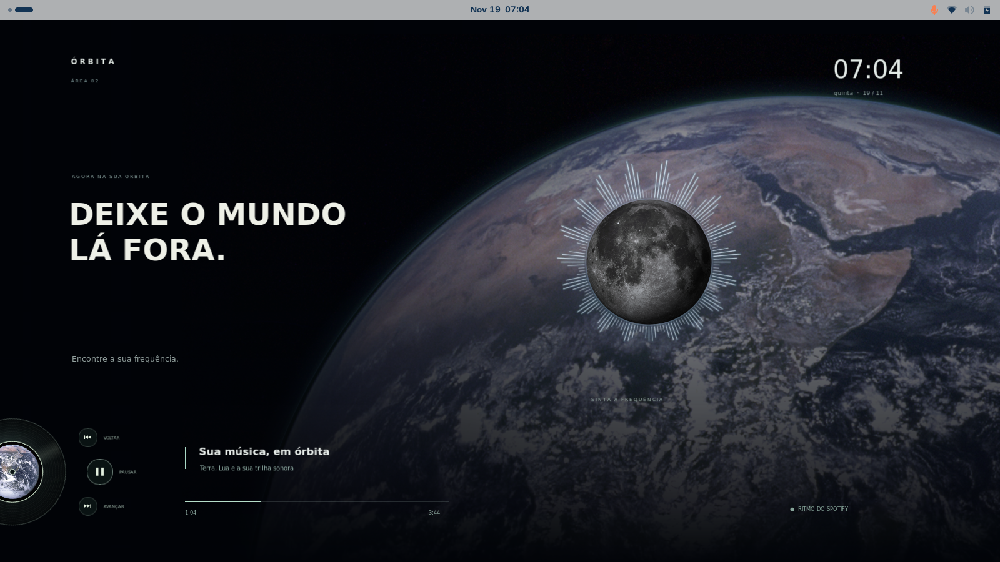

# Órbita

Papel de parede musical para **Zorin OS 18 / GNOME Shell 46**. Terra e Lua com profundidade e movimento suave, letras sincronizadas e um vinil com a capa do álbum.



O visual aparece **somente na segunda área de trabalho, no monitor principal**. As outras áreas mantêm o papel de parede atual.

## Instalar pelo pacote .deb

Baixe o [instalador .deb](https://github.com/giovannibl13/Orbita-Desktop/releases/download/v1.0.0/orbita-desktop_1.0.0_all.deb) na [página da versão](https://github.com/giovannibl13/Orbita-Desktop/releases/tag/v1.0.0) e instale pelo aplicativo de instalação de pacotes do Zorin. Pelo terminal, na pasta do arquivo:

```bash
sudo apt install ./orbita-desktop_1.0.0_all.deb
```

Abra **Órbita — Configurar** no menu de aplicativos e clique em **Ativar papel de parede na minha conta**. Saia da sessão do Zorin e entre novamente. Depois, abra a segunda área de trabalho.

O pacote instala as dependências. A ativação e a configuração do Spotify são feitas pela sua conta, sem `sudo`.

## Spotify: letras, capa e ritmo

1. Instale o Spotify para Linux pelo pacote **.deb**, abra e entre na sua conta.
2. Feche o Spotify.
3. Abra **Órbita — Configurar** e clique em **Conectar letras e ritmo do Spotify**.
4. Abra o Spotify pelo menu de aplicativos.

A conexão usa Spicetify **2.46.4**, baixado da versão oficial e conferido por SHA-256. Ela cria uma cópia do Spotify dentro da sua conta, preservando a instalação original do sistema. Spotify e Spicetify **não estão incluídos** nos arquivos distribuídos por este projeto.

Esta integração requer Linux **x86_64** e Spotify instalado em `/usr/share/spotify`, com as preferências em `~/.config/spotify/prefs`. As versões Flatpak e Snap não são suportadas por este instalador. A compatibilidade foi verificada com Spotify 1.3.4.258 e pode depender de mudanças futuras do Spotify.

O papel de parede também lê players compatíveis com **MPRIS**. Sem a conexão direta com Spotify, a busca alternativa de letras usa o **LRCLIB**. Letras estimadas exibem **Sincronização aproximada**.

## O que acompanha a música

- O vinil mostra a capa do álbum, gira durante a reprodução e para na pausa. Os botões voltam, pausam e avançam a faixa.
- As letras entram com uma transição de movimento e opacidade.
- Com som no computador, as luzes ao redor da Lua reagem ao áudio de saída por PipeWire e FFTW.
- Pelo Spotify Connect, quando há análise disponível para a faixa, os tempos de batidas e a intensidade da gravação dirigem a animação. O painel mostra **Ritmo do Spotify**. Essa animação não representa uma captura do áudio do celular.
- Sem áudio local e sem análise da faixa, aparece **Animação ambiente**.
- Terra e Lua se movem suavemente em planos diferentes, inclusive com a música pausada. Letras, relógio e controles ficam fixos.

Ao sair da segunda área ou bloquear a sessão, a captura de áudio é encerrada. O Órbita captura apenas a **saída de áudio**, sem usar o microfone.

## Instalar pelo pacote portátil ou código-fonte

Extraia `orbita-desktop-1.0.0-portatil.tar.gz`. Instale as dependências do Zorin/Ubuntu 24.04:

```bash
sudo apt install python3 python3-gi gir1.2-gtk-3.0 gir1.2-gdkpixbuf-2.0 pipewire-bin libfftw3-double3 fonts-dejavu-core
```

Na pasta extraída, execute como usuário normal:

```bash
./instalar.sh
```

Para abrir a janela de configuração sem o .deb:

```bash
/usr/bin/python3 configurar.py
```

O GNOME Shell 46 precisa estar instalado e ser o ambiente da sessão. As demais versões do GNOME não fazem parte do suporte desta versão.

## Ajustar o movimento e a aparência

O arquivo em uso fica em `~/.local/share/gnome-shell/extensions/orbita-desktop@local/moon-style.json` e é recarregado automaticamente em poucos segundos com a segunda área aberta.

`earthFloatX`, `earthFloatY` e `earthSpeed` controlam a Terra. `floatXPixels`, `floatPixels`, `floatXSpeed` e `floatSpeed` controlam o deslocamento da Lua. As amplitudes são proporcionais a uma tela de 1920 × 1080. A configuração padrão já inclui o movimento perceptível e suave.

A reinstalação preserva os ajustes existentes. Para restaurar os padrões do pacote:

```bash
/usr/bin/python3 instalar.py --restaurar-aparencia
```

## Atualizar e remover

Depois de atualizar o .deb, abra o configurador e ative novamente. Mudanças no código visual são carregadas no próximo login. Alterações apenas na aparência são aplicadas em execução.

Para desativar, use o configurador ou:

```bash
orbita-desktop --desativar
```

Para remover a instalação e os dados da sua conta, feche o Spotify e use **Remover da minha conta**. Depois, se instalou o .deb:

```bash
sudo apt remove orbita-desktop
```

A remoção restaura o atalho anterior do Spotify quando existir, remove a cópia criada pelo Órbita e preserva a instalação original. A configuração do papel de parede das demais áreas é preservada.

## Dados e conexão

Cada instalação cria sua própria chave para um receptor que escuta somente em `127.0.0.1`. A autenticação do Spotify permanece no aplicativo. O conector entrega apenas identificador da faixa, letras e dados selecionados da análise rítmica ao receptor local.

A busca alternativa envia título, artista e dados da versão ao LRCLIB. As capas são carregadas do endereço informado pelo player. Letras, análise e miniaturas ficam no cache da conta. O pacote não contém contas, tokens, cookies ou bibliotecas pessoais de música.

## Desenvolver e publicar

A versão pública está em `VERSION`; a revisão da extensão GNOME está em `metadata.json`.

```bash
/usr/bin/python3 scripts/check.py
/usr/bin/python3 scripts/build.py
```

A geração usa Python, `dpkg-deb` e os arquivos deste repositório, sem baixar dependências para o pacote. Os instaladores, o código-fonte em ZIP e `SHA256SUMS` são gravados em `dist/`.

Veja [como publicar no GitHub](docs/PUBLICAR.md), [detalhes da instalação](docs/INSTALACAO.md) e [as alterações da versão](CHANGELOG.md). O fluxo em `.github/workflows/release.yml` testa e gera os arquivos no GitHub Actions. Ao enviar uma tag `v1.0.0`, também publica a Release com esses arquivos.

## Licenças e créditos

Código e ícone: **MIT**, © 2026 Giovanni Puiatti e contribuidores. [Licença do código](LICENSE).

Lua: **Gregory H. Revera**, [FullMoon2010](https://commons.wikimedia.org/wiki/File:FullMoon2010.jpg), [CC BY-SA 3.0](https://creativecommons.org/licenses/by-sa/3.0/). O arquivo original é preservado; o recorte, a iluminação e a cor são aplicados em execução. A prévia do projeto contém essa adaptação e é disponibilizada sob a mesma licença.

Terra: **NASA / tripulação Apollo 17**, [The Earth seen from Apollo 17](https://commons.wikimedia.org/wiki/File:The_Earth_seen_from_Apollo_17.jpg), domínio público nos Estados Unidos. O arquivo original é preservado, com sombras e atmosfera desenhadas em camadas.

Veja os avisos completos em [THIRD_PARTY_NOTICES.md](THIRD_PARTY_NOTICES.md). Órbita é um projeto independente, sem vínculo com Spotify, NASA, GNOME ou Zorin.
